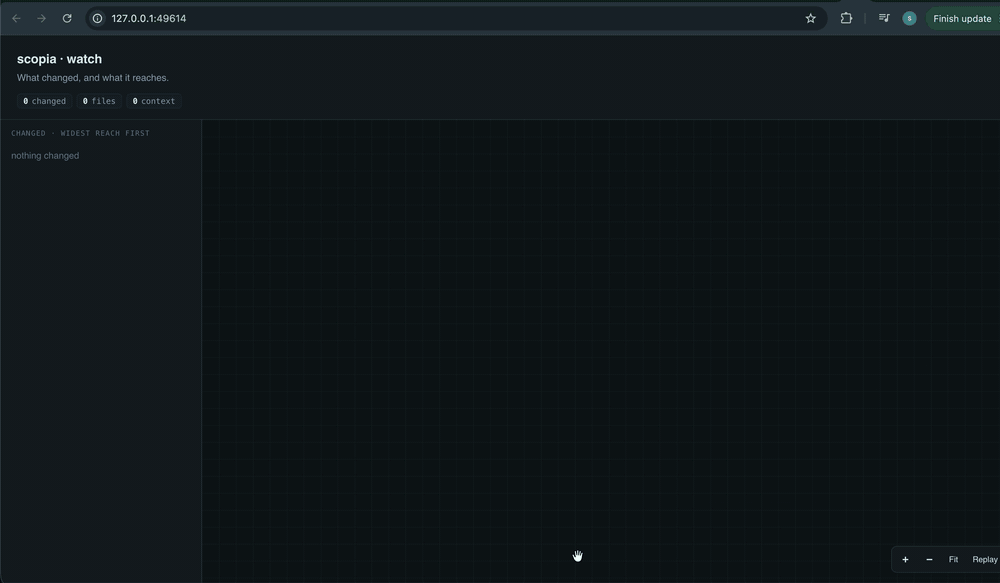
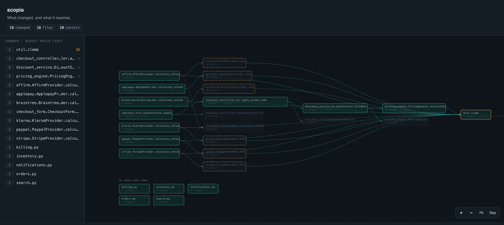
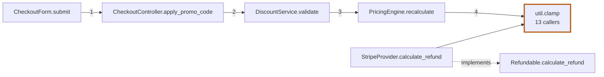

# scopia

**σκοπιά — the watchtower. See what your AI is building, while it builds it.**

<p align="center">
  
</p>

AI agents write code at a speed and volume no reviewer can match. By the time the agent
says *done*, you are staring at a twenty-file diff in alphabetical order, with no idea
which piece matters or how the pieces connect. The hard part of review is no longer
reading the code — it is getting **the lay of the land**.

`scopia` is a visualisation layer for code changes. It draws **one graph** — what
changed, what calls it, and what it calls — and it does so two ways:

- **Live** — watch the graph grow in real time *as the agent writes*, so you already
  understand the change before it finishes.
- **Static** — point it at any commit, branch or range and get the same graph for code
  that was already committed.

No config, no init step, no language servers required. Just git and Python.

---

## Quick start

```bash
pip install scopia            # or: uv tool install scopia / pipx install scopia
```

Run these from anywhere inside a git repository:

| I want to… | Command |
|---|---|
| **Watch the graph build live** while an agent works | `scopia --watch --html` |
| Watch live in the terminal instead | `scopia --watch` |
| Review my uncommitted work | `scopia` |
| Analyse a past commit | `scopia <sha>~1..<sha>` |
| Review a branch (the pull-request case) | `scopia main..` |
| Analyse the last 5 commits | `scopia HEAD~5..HEAD` |
| Save a clickable report to share | `scopia main.. --html review.html` |
| Paste a diagram into a PR comment | `scopia --format mermaid` |
| Feed it to other tools | `scopia --format json` |
| Trace each change back to the route/job/command that triggers it | `scopia --to-entry` |
| Sharpen uncertain edges with a language server | `scopia --lsp` |

Requires **Python 3.10+** and **git**. Every dependency ships as a pre-built wheel, so no
compiler is needed. Check with `scopia --version`.

---

## Live mode: review while the agent is still typing

```bash
scopia --watch --html
```

This opens a live page in your browser. Start your agent in another window and watch the
graph fill in as files land: changed symbols in green, the code they touch around them,
new arrivals marked `● just now`.

- **The page patches itself in place.** The node you are reading stays selected and the
  view does not jump when the agent saves.
- **Half-written code is held, not thrashed.** A file that does not parse yet keeps the
  last good graph on screen, with a note.
- **No-op rewrites are ignored.** A formatter or a `touch` that leaves the graph
  unchanged causes no redraw.
- **Private by default.** It is served on `127.0.0.1` only (it serves your source), on a
  random port. `--no-open` prints the URL instead of opening a browser.

```bash
scopia --watch               # same idea, rendered in the terminal
scopia --watch --html r.html # live page, and keep r.html up to date too
```

Ctrl-C leaves your terminal as it found it.

---

## Static mode: understand a commit after the fact

The same graph works on history. Give it a commit and it shows what that commit changed
and what the change reaches — useful for reviewing a teammate's (or an agent's) PR, for
auditing something that already merged, or for onboarding onto unfamiliar code.

```bash
scopia HEAD~1..HEAD --html commit.html && open commit.html
```

<p align="center">
  
</p>

A real 16-file commit adding refunds to a payments codebase. Left to right: seven provider
classes gained a `calculate_refund`, and a new checkout path runs four layers deep to
land on `util.clamp` — a **one-line edit to existing code that 13 places call**, drawn
with an amber border. Dashed boxes are unchanged context; the five files at the bottom are
changed but untraceable (`NO CONNECTIONS FOUND`). Click any node to focus its
neighbourhood; the rest recedes rather than disappearing. One self-contained file — no
CDN, no network, opens from disk years from now.

Pass `<sha>~1..<sha>` for "what this commit changed":

```bash
scopia 3036712be90~1..3036712be90
```

`~1` has no meaning on a repo's first commit; use `scopia <sha>` there. Skip merge
commits — `~1` follows only the first parent and reports something misleading.

---

## Reading the output

The same commit as plain text:

```
$ scopia HEAD~1..HEAD

16 symbols touched across 16 files  (10 shown for context)

CALL CHAINS  — indented → means the line above calls it
  checkout_form.CheckoutForm.submit  1 line changed · existing code  app/
     └→ checkout_controller.CheckoutController.apply_promo_code  3 lines changed  app/
        └→ discount_service.DiscountService.validate  4 lines changed  app/
           └→ pricing_engine.PricingEngine.recalculate  3 lines changed  app/
              └→ util.clamp  1 line changed · called from 13 places · existing code  app/

  stripe.StripeProvider.calculate_refund  3 lines changed  app/providers/
     └→ stripe.StripeProvider.fees  called from ~6 places · context  app/providers/
        └→ util.clamp  1 line changed · called from 13 places · existing code  app/
     ┈ implements refundable.Refundable.calculate_refund

NO CONNECTIONS FOUND  — scopia could not trace these; not a statement that they are safe
  billing.py  1 line changed  config/
  inventory.py  1 line changed  config/
```

Three things a file list cannot tell you, all visible at a glance:

1. **A new checkout path runs four layers deep** and bottoms out in `util.clamp` — a
   one-line edit to existing code that **13 places call**. The riskiest change in the
   diff is one line long.
2. **Several providers implement the same new interface method**, grouped by their
   `implements` edges — read the pattern once instead of seven times.
3. **`ApplepayProvider` never calls `clamp`**, unlike its siblings. scopia does not
   claim that is wrong, only that it differs — which is where attention belongs.

| Section | What it means |
|---|---|
| `CALL CHAINS` | What changed and what it reaches. Indentation is a call: the line above calls the line below. Heaviest chain first. |
| `CHANGED, REFERENCED FROM` | Changed things that call nothing themselves, shown with who calls *them*. Small edits with wide reach land here. |
| `NO CONNECTIONS FOUND` | scopia could not trace these. **Not** a claim that they are safe. |
| `NOT ANALYSED` | Changed files in unsupported languages. The graph says nothing about them. |
| `NOT CERTAIN` | Edges matched by name that may be wrong, each with its reason. Leads, not facts. |

| Annotation | Meaning |
|---|---|
| `3 lines changed` | Lines changed inside that symbol |
| `new` | The file did not exist before |
| `existing code` | Edits something that was already there — other code may depend on it |
| `called from 12 places` | Repo-wide caller count |
| `~12` | Count is shared across several same-named definitions; approximate |
| `context` | Unchanged, shown only to orient you |
| `+3 hidden` | Neighbours cut by `--max-nodes` |

**The number that matters is callers, not lines.** `1 line changed · called from 40
places` deserves more attention than a fifty-line change nothing calls.

### Mermaid and JSON

`--format mermaid` prints a diagram GitHub renders natively — paste it straight into a
pull-request comment:



`--format json` is for anything downstream. Every edge carries its provenance
(`static`, `inferred`, …), so a consumer can tell a resolved call from a guess. Nodes
carry `touched`, `added`, `fan_in`, `changed_lines`; the top level reports `truncated`,
`utilities_hidden`, `files_changed` and `unparsed`.

---

## Options

```
scopia [revisions] [options]

  --html [PATH]      write a self-contained, clickable HTML report
                     (with --watch and no PATH: serve a live page)
  --watch            follow the working tree and redraw as files settle
  --to-entry         climb callers until each chain reaches an entry point
  --lsp              confirm name-matched calls with a language server, if installed
  --no-open          with --watch --html, print the URL instead of opening it
  --format FORMAT    text (default), mermaid, or json
  --hops N           neighbour hops to expand (default: 1)
  --max-nodes N      cap on drawn nodes (default: 60)
  --utility N        hide unchanged helpers called from more than N places
                     (default: 12; 0 keeps everything)
  --exclude GLOB     skip paths matching GLOB (repeatable)
  --always           draw even when the diff is below the gate
  --jobs N           parser processes used when indexing
  --no-color         disable ANSI colour
  --version          print the version
```

**Too noisy?** Hide shared plumbing — a logger every handler calls says nothing about
*this* change — or exclude paths (`vendor/`, `node_modules/`, `.venv/`, `migrations/`,
`dist/`, `build/` and similar are already skipped):

```bash
scopia --utility 6
scopia --exclude 'tests/*' --exclude 'generated/*'
```

**Too small?** Raise the node cap if the report says nodes were hidden (edges to cut
nodes are not drawn, which can make a symbol look unreferenced), look further out, or
force a graph for a tiny diff:

```bash
scopia --max-nodes 300
scopia --hops 2
scopia --always
```

---

## Languages

| Language | Extensions | Status |
|---|---|---|
| Python | `.py` `.pyi` | supported — including aliased imports (`from x import run as v3`) |
| PHP | `.php` `.phtml` | supported — no PHP runtime needed, parsed via tree-sitter |
| Java | `.java` | supported — no JDK needed; reads the type each parameter, field and local declares |
| React | `.jsx` `.tsx` `.js` `.ts` `.mjs` `.cjs` `.mts` `.cts` | supported — no Node, no `tsc`, no `node_modules` |

**PHP** resolves the class a call site names — `app(Service::class)->show()`,
`new Service()`, `Service::show()`, typed properties — including inherited methods. On a
Laravel-shaped app that removed roughly a third of all edges as false.

**React:** `<Button />` is a call (composition *is* the call graph; `<div>` is left
alone); `const Panel = () => …`, `memo(forwardRef(…))`, `useCallback(…)` and
`styled.div\`…\`` are definitions, so a one-line edit inside a handler is attributed to
the handler rather than the 200-line component around it; hooks are ordinary calls;
handlers wired through props are followed and listed as references. TypeScript is read
where it states a type, and `.js`/`.ts`/`.tsx` are one language, so a call between them
is an ordinary edge.

### Sharper edges with a language server

```bash
pip install "scopia[lsp]"   # adds jedi-language-server — pure Python, no Node
scopia --lsp                # or: scopia --watch --lsp
```

Where scopia could only match a call by name, `--lsp` asks a language server where the
call really goes. One confirmed target becomes a solid edge; a definition outside your
repo (`dict.get`, the standard library) removes the name-matched edges outright. If no
server is installed, or it fails or times out, you get exactly the graph you would have
had without the flag — plus a line saying so. In watch mode the graph is drawn from
tree-sitter immediately and upgraded when answers arrive, so a slow server never stalls
a redraw.

Measured on Python (uncertain edges as a share of all edges, before → after):

| Repo | Before | After |
|---|---|---|
| scopia | 30% | 4% |
| pygls | 67% | 10% |
| parso | 64% | 21% |
| jedi (190,000 edges, uncapped) | 67% | 64% |

The last row is the honest limit: in heavily dynamic code a language server sharpens what
types can settle, and does not conjure types that are not there. Python is the only
language wired up so far.

Adding a language means writing **one adapter**. See [CONTRIBUTING.md](CONTRIBUTING.md).

---

## The ideas it is built on

- **A one-line change is a first-class change.** The unit of analysis is the enclosing
  function, never the size of the hunk. A one-line sign flip in a helper called from forty
  places outranks a two-hundred-line rewrite of something nobody calls.
- **Uncertainty is shown, never disguised.** Every edge carries its provenance; a call
  through an unknown receiver is marked `inferred` even when only one candidate exists.
- **It does not claim knowledge it lacks.** Unsupported files are listed, not omitted.
  Untraceable symbols are "no connections found", not "no edges" — a reviewer reads the
  second as "safe to skip".
- **It is not a correctness checker.** scopia does not judge code or hunt for bugs; it
  reduces how much you must read. The metric it optimises is hunks a reviewer *didn't*
  have to open.
- **Small diffs get no graph.** Touch fewer than three files with nothing connecting them
  and scopia tells you to just read the diff.

---

## How it works

1. `git diff --unified=0` gives exact changed line ranges; context lines would overstate
   the blast radius. Untracked files are added separately.
2. Each changed line maps to its **smallest enclosing definition**.
3. A symbol and reference index over the repo, cached per git blob SHA in `.git/scopia/`,
   so only files whose content actually changed are ever re-parsed.
4. One hop of expansion to callers and callees — never a transitive closure, so graph
   size scales with the diff rather than the repo.
5. Edges resolved and tagged by how the call named its target.

A 1,200-file repo with a 200-file diff: **1.7s cold, 0.9s warm.** To force a clean
re-index, `rm -rf .git/scopia`.

---

## Development

```bash
git clone https://github.com/printSamarth/scopia && cd scopia
python3 -m venv .venv && .venv/bin/pip install -e ".[dev]"
.venv/bin/python -m pytest -q
.venv/bin/ruff check .
```

## Status

First stable release. The graph, live watch mode and all four language adapters work. Planned: hunk
clustering (read a repeated pattern once, then only what differs), framework/DI edge
recognition, and runtime-trace ingestion for the dynamic dispatch static analysis cannot
see.

## License

MIT
