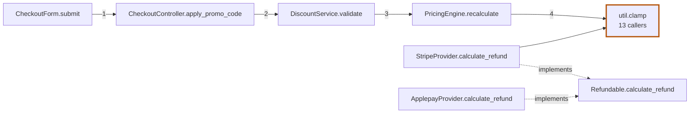

# scopia

**σκοπιά — the watchtower. Read the terrain before you walk into it.**

Agents write code faster than people can read it. A twenty-file diff, shown as a flat
alphabetical list, hides the one thing a reviewer needs first: how the changed pieces
relate to each other.

`scopia` reads a git diff and draws **one graph** — what changed, what calls it, and
what it calls.

```bash
scopia
```

No config, no init step, no language servers. Just git and Python.

---

## Install

```bash
uv tool install scopia
```

```bash
pipx install scopia
```

```bash
pip install scopia
```

Requires **Python 3.10+** and **git**. Every dependency ships as a pre-built wheel, so
no compiler is needed. Verify with:

```bash
scopia --version
```

---

## Usage

Run it from anywhere inside a git repository.

### Review what you're working on

Uncommitted work against `HEAD` — this is the zero-argument default, and the one you'll
use most:

```bash
scopia
```

Untracked files are included. `git diff` cannot see them, and a brand-new file is often
the bulk of a change.

### Review a specific commit

Pass `<sha>~1..<sha>` — "from its parent to it", i.e. what that commit changed:

```bash
scopia 3036712be90~1..3036712be90
```

```bash
scopia HEAD~1..HEAD
```

`~1` has no meaning on a repo's first commit; use `scopia <sha>` there instead.

### Review a branch or a range

Your branch against `main` — the pull-request case:

```bash
scopia main..
```

```bash
scopia HEAD~5..HEAD
```

```bash
scopia v1.2.0..v1.3.0
```

Skip merge commits — `~1` follows only the first parent and reports something
misleading.

### Get a clickable report

```bash
scopia --html review.html && open review.html
```

Click any node to focus its neighbourhood; everything unrelated recedes rather than
disappearing. A panel lists what it calls and what calls it, both clickable, so you can
walk the graph hop by hop. One self-contained file — no CDN, no network, opens from disk
years from now.

### As a mermaid diagram

`--format mermaid` prints a diagram GitHub renders natively — paste it straight into a
pull-request comment:

```bash
scopia --format mermaid
```



### As JSON

`--format json` for anything downstream. Every edge carries its provenance, so a
consumer can tell a resolved call from a guess:

```bash
scopia --format json
```

```json
{
  "nodes": [
    {
      "uid": "app/util.py::clamp",
      "label": "clamp",
      "path": "app/util.py",
      "kind": "function",
      "touched": true,
      "added": false,
      "gone": false,
      "pre_existing": true,
      "changed_lines": 1,
      "fan_in": 13,
      "fan_in_shared": false,
      "hidden_in": 0,
      "hidden_out": 0
    }
  ],
  "edges": [
    {
      "src": "app/pricing_engine.py::PricingEngine.recalculate",
      "dst": "app/util.py::clamp",
      "kind": "call",
      "provenance": "static",
      "order": 4
    }
  ],
  "truncated": 0,
  "utilities_hidden": 0,
  "files_changed": 16,
  "unparsed": [["tools/config.json", 24]]
}
```

---

## Reading the output

A real 16-file change adding refunds to a payments codebase:

```
$ scopia HEAD~1..HEAD

16 symbols touched across 16 files  (10 shown for context)

CALL CHAINS  — indented → means the line above calls it
  checkout_form.CheckoutForm.submit  1 line changed · existing code  app/
     └→ checkout_controller.CheckoutController.apply_promo_code  3 lines changed  app/
        └→ discount_service.DiscountService.validate  4 lines changed  app/
           └→ pricing_engine.PricingEngine.recalculate  3 lines changed  app/
              └→ util.clamp  1 line changed · called from 13 places · existing code  app/

  stripe.StripeProvider.calculate_refund  3 lines changed  app/providers/
     └→ stripe.StripeProvider.fees  called from ~6 places · context  app/providers/
        └→ util.clamp  1 line changed · called from 13 places · existing code  app/
     ┈ implements refundable.Refundable.calculate_refund

  applepay.ApplepayProvider.calculate_refund  3 lines changed  app/providers/
     └→ applepay.ApplepayProvider.fees  called from ~6 places · context  app/providers/
        └→ util.clamp  1 line changed · called from 13 places · existing code  app/
     ┈ implements refundable.Refundable.calculate_refund

NO CONNECTIONS FOUND  — scopia could not trace these; not a statement that they are safe
  billing.py  1 line changed  config/
  inventory.py  1 line changed  config/
  orders.py  1 line changed  config/
```

Three things a file list cannot tell you, all visible at a glance:

1. **A new checkout path runs four layers deep** and bottoms out in `util.clamp` — a
   one-line edit to existing code that **13 places call**. The riskiest change in the
   diff is one line long.
2. **Six providers implement the same new interface method**, grouped by their
   `implements` edges — so you read the pattern once instead of six times.
3. **`ApplepayProvider` never calls `clamp`**, unlike its siblings. scopia does not
   claim that is wrong, only that it differs — which is where attention belongs.

| Section | What it means |
|---|---|
| `CALL CHAINS` | What changed and what it reaches. Indentation is a call: the line above calls the line below. Heaviest chain first. |
| `CHANGED, REFERENCED FROM` | Changed things that call nothing themselves, shown with who calls *them*. Small edits with wide reach land here. |
| `NO CONNECTIONS FOUND` | scopia could not trace these. **Not** a claim that they are safe. |
| `NOT ANALYSED` | Changed files in unsupported languages. The graph says nothing about them. |
| `NOT CERTAIN` | Edges matched by name that may be wrong, each with its reason. Leads, not facts. |

Annotations on each line:

| Annotation | Meaning |
|---|---|
| `3 lines changed` | Lines changed inside that symbol |
| `new` | The file did not exist before |
| `existing code` | Edits something that was already there — other code may depend on it |
| `called from 12 places` | Repo-wide caller count |
| `~12` | Count is shared across several same-named definitions; approximate |
| `context` | Unchanged, shown only to orient you |
| `+3 hidden` | Neighbours cut by `--max-nodes` |

**The number that matters is callers, not lines.** `1 line changed · called from 40
places` deserves more attention than a fifty-line change nothing calls.

---

## Options

```
scopia [revisions] [options]

  --html PATH        write a self-contained, clickable HTML report
  --format FORMAT    text (default), mermaid, or json
  --hops N           neighbour hops to expand (default: 1)
  --max-nodes N      cap on drawn nodes (default: 60)
  --utility N        hide unchanged helpers called from more than N places
                     (default: 12; 0 keeps everything)
  --exclude GLOB     skip paths matching GLOB (repeatable)
  --always           draw even when the diff is below the gate
  --jobs N           parser processes used when indexing
  --no-color         disable ANSI colour
  --version          print the version
```

### When the graph is too noisy

Hide shared plumbing more aggressively — a logger or response helper every handler calls
says nothing about *this* change:

```bash
scopia --utility 6
```

Exclude paths (`vendor/`, `node_modules/`, `site-packages/`, `.venv/`, `migrations/`,
`dist/`, `build/`, `*.min.js` are already skipped):

```bash
scopia --exclude 'tests/*' --exclude 'generated/*'
```

### When the graph is too small

Raise the node cap if the report says nodes were hidden — edges to cut nodes are not
drawn, which can make a symbol look unreferenced:

```bash
scopia --max-nodes 300
```

Expand further out from the change:

```bash
scopia --hops 2
```

Draw a graph even for a small diff:

```bash
scopia --always
```

---

## Languages

| Language | Status |
|---|---|
| Python | supported — including aliased imports (`from x import run as v3`) |
| PHP | supported — no PHP runtime needed, parsed via tree-sitter |

For PHP it reads the class a call site names — `app(Service::class)->show()`,
`new Service()`, `Service::show()`, and typed properties — including methods inherited
from a parent. On a Laravel-shaped app that removed roughly a third of all edges as
false.

Adding a language means writing **one adapter**. See [CONTRIBUTING.md](CONTRIBUTING.md).

---

## The ideas it is built on

**A one-line change is a first-class change.** The unit of analysis is the enclosing
function, never the size of the hunk. A one-line sign flip in a helper called from forty
places outranks a two-hundred-line rewrite of something nobody calls.

**Uncertainty is shown, never disguised.** Every edge carries its provenance. A call
naming its target's class resolves precisely; one through an unknown receiver is marked
`inferred` even when only one candidate exists, because the real target may be a class
outside the repo.

**It does not claim knowledge it lacks.** Unsupported files are listed, not omitted.
Untraceable symbols are "no connections found", not "no edges" — a reviewer reads the
second as "safe to skip".

**It is not a correctness checker.** scopia does not judge code or hunt for bugs; it
reduces how much you must read. The metric it optimises is hunks a reviewer *didn't*
have to open.

**Small diffs get no graph.** Touch fewer than three files with nothing connecting them
and scopia tells you to just read the diff.

---

## How it works

1. `git diff --unified=0` gives exact changed line ranges; context lines would overstate
   the blast radius. Untracked files are added separately.
2. Each changed line maps to its **smallest enclosing definition**.
3. A symbol and reference index over the repo, cached per git blob SHA in `.git/scopia/`,
   so only files whose content actually changed are ever re-parsed.
4. One hop of expansion to callers and callees — never a transitive closure, so graph
   size scales with the diff rather than the repo.
5. Edges resolved and tagged by how the call named its target.

A 1,200-file repo with a 200-file diff: **1.7s cold, 0.9s warm.**

To force a clean re-index:

```bash
rm -rf .git/scopia
```

---

## Development

```bash
git clone https://github.com/printSamarth/scopia && cd scopia
python3 -m venv .venv && .venv/bin/pip install -e ".[dev]"
```

```bash
.venv/bin/python -m pytest -q
```

```bash
.venv/bin/ruff check .
```

```bash
rm -rf dist && .venv/bin/python -m build
```

---

## Status

Alpha. The graph and both language adapters work. Planned: hunk clustering (read a
repeated pattern once, then only what differs), framework/DI edge recognition, and
runtime-trace ingestion for the dynamic dispatch static analysis cannot see.

## License

MIT
